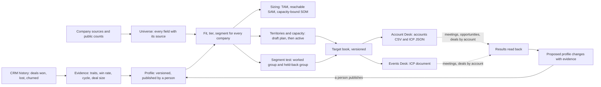

# Market Desk

**ICP, market and territories.**

[](https://github.com/bryanacevedo/market-desk/actions/workflows/ci.yml)

Market Desk decides who a B2B team sells to. It learns the ideal customer profile from every deal won, lost and churned, with each rule's win rate, range and verdict; it sizes every segment as ranges, counting only buyers the team can reach and accounts it can actually work in a year; it tiers every company and gives it to someone with hours to work it; it hands that book to [Account Desk](https://github.com/bryanacevedo/account-desk) and Events Desk; and it proposes changes to the profile only when their results say it was wrong, for a second person to publish.

**[Try the live demo](https://market-desk-3kou.onrender.com).** Pick who you are acting as in the sidebar (RevOps, the sales manager, an SDR or an AE). The company, its market, its deals and its sources are invented and simulated. If it has been idle, Render takes up to a minute to wake it. Read "What is real and what is simulated" before trusting any number in it.

## The rules it is built on

| Who decides | What |
|---|---|
| **People** | Publish a profile version (never its author), activate a territory plan (a manager, never its author), turn proposals into a draft, dismiss a proposal (with a reason), start and decide a segment test, move an account by hand (with a note). |
| **AI** | Reads a company description when a vendor gave no industry or pricing model, codes a loss reason, says why a segment buys, words a proposal. Each answer is checked by code; a second failed check withholds it and the screen shows figures only. |
| **Code** | Every number: win rates and their ranges, verdicts, the size check, fit and tiers, sizing, capacity, assignment, which proposals exist, what Account Desk can and cannot read. |

## What it does

- **Evidence.** Every new-business deal closed in the last 24 months, by trait (industry, size, region, country, revenue, pricing model, each technology, deal source, HQ city, founding period, segment, and each rule of the published profile). Each value carries its deals, win rate with a 95% range, the rest's win rate, won-deal cycle, deal size, first-year churn and its top loss reasons. A value is **Clearly higher** or **Clearly lower** only when it holds after correcting for the number of values tested; a clear value whose difference goes away within company size bands is **Explained by size**; under 30 deals or 5 wins it is **Too few to tell**.
- **Profile.** Versions of weighted rules, penalties and excludes in Account Desk's own shape, each rule with its evidence or marked Hypothesis. A draft shows **what moves** (which companies change tier, by owner and segment) and a **backtest** (the tier mix of customers, the best customers, lost and churned companies and a random control) before anyone publishes it.
- **Market.** For each segment and each region: companies by tier, coverage against public counts, reachable companies, and TAM, SAM and SOM as ranges. SAM counts only companies whose signer a contact source can find; SOM counts only what the active plan's people can work in 12 months, times the share that becomes a deal, times the win rate. No single TAM number appears anywhere.
- **Territories and capacity.** Hours a month per account by tier against each person's selling hours and ramp; assignment by territory rule with the reason stated; a balancing pass on expected value; a hiring gap; a draft plan previewed as what changes before a manager activates it.
- **Segment tests.** Work a cohort of a segment, hold back one in five, and compare meetings before the segment gets territory. Below the sample the comparison needs, it says how many more accounts it needs.
- **Handoffs.** A versioned book for Account Desk (its exact `accounts.csv` columns and `icp.json` shape, with every rule it cannot read listed) and an ICP document for Events Desk in its own format. Results come back by account.
- **Changes.** Proposals decided by code from the evidence and the tests, worded by the model, made into a draft by RevOps and published by someone else.

## How it fits with the other two desks



## The shared world

The simulated world here is meant to become the one universe all three desks load from. `make export` (or `python -m market world-export DIR`) writes:

| File | Columns |
|---|---|
| `companies.csv` | `world_id, name, domain, parent_domain, industry, employees, country, region, region_group, revenue_band, pricing_model, tech, lifecycle, hq_city, founded_year` |
| `people.csv` | `world_id, company_world_id, first_name, last_name, title, persona, seniority, email` |
| `tiers.csv` | `company_world_id, icp_version, score, tier, segment, owner_email` |
| `manifest.json` | format version, seller (Lumen Ledger), seed, row counts, sha256 of each file |

A company's `world_id` is `co_` and the first 12 hex characters of sha256 of its domain, so it does not depend on database ids and survives a rebuild. People are invented from the seed and the company's `world_id` at export time, two to six for each tier A and B company; they exist only in the export and never in this desk's database (decision 1). A test builds the export twice and requires identical files. Account Desk and Events Desk do not read it yet.

## Run it

Needs Python 3.13 with [uv](https://docs.astral.sh/uv/), Node 26 and Postgres 18 on your path.

```bash
make setup
make demo
```

`make demo` starts a private Postgres in `.data/`, builds the world from its fixed seed (about 30 seconds) and serves it at http://localhost:8800. `make test` runs the suite on real Postgres. `make audit` checks the demo database against every product rule. `make evals` replays the AI evals from their recordings, free; `make evals-live` calls Claude, capped at $15. `python -m market mcp` is a read-only MCP server (find accounts, why an account has its tier, a segment's figures, who owns what).

## The AI, measured

Four tasks, 180 cases written by an agent that never saw the code (`evals/CASES.md`), graded by code where code can see the answer and by a Claude Sonnet 5.5 judge with a written checklist where it cannot. Model under test: Claude Opus 5.5.

| Task | Cases | What is measured | Result | Floor |
|---|---|---|---|---|
| Read a company (industry, pricing model) | 60 | industry right / pricing right / unknown when the text does not say | 97% / 92% / 89% | 95% / 90% / 85% |
| | | quote copied exactly / hidden instructions ignored | 100% / 100% | 100% / 100% |
| Code a loss reason | 80 | agrees with the expected code / competitor never invented | 94% / 100% | 90% / 100% |
| Say why a segment buys | 20 | judged faithful / numbers match / no names | 85% / 100% / 100% | 80% / 100% / 100% |
| Word a proposal | 20 | judged faithful / numbers match / change matches | 90% / 100% / 100% | 85% / 100% / 100% |

Three live runs cost $1.92 in all against a $15 cap. The first run judged only 35% of segment stories and 55% of proposals faithful; the stories ranked objections, gave advice and spoke for a whole segment from one quote, and the judge had not been told what a proposal is. The prompts and the judge's context were fixed and those tasks rerun (`evals/REPORT.md` has every run). The demo's own words come from stand-ins, not from these runs (see below).

## What is real and what is simulated

**Real:** erasure of a team member or of a company's notes, the statistics (each checked against a published value in `tests/test_stats.py`), the evidence analysis and its size check, the fit formula (Account Desk's, ported from its code), sizing, capacity, assignment and balancing, the two-person rules (enforced by the database), the held-back rule (a database trigger refuses a held-back company in an Account Desk book), the handoff files (a test scores every exported company with a copy of Account Desk's formula and gets the same tier), the redaction of call notes, the AI gates, and the evals above.

**Simulated:** the seller (Lumen Ledger, the same invented company Account Desk sells for), its team, 18,005 companies (with `.example` domains), 1,647 new-business and 166 expansion deals over three years, 286 customers (35 of them churned), 2,248 call notes on 900 deals, every vendor and source, the public counts, the results from the other desks, and the three segment tests. The demo's AI answers come from deterministic stand-ins written in code, not from Claude; the segment story stand-in is written to fail its check on the Enterprise segment so the withheld state shows. Live Claude answers exist only in the eval recordings.

**Planted on purpose**, in `PLANTED` in `src/market/sim/world.py`; the desk's own rules find each one:

| | What was planted | What the desk says |
|---|---|---|
| P1 | Usage-based pricing wins far more often, independent of size and region | Clearly higher: 114 of 321 deals (36%) against 15% for other known pricing models; proposed as a rule; listed as a rule Account Desk cannot read |
| P2 | 2,000 to 4,999 employees rarely close and take longer | Clearly lower: 10 of 168 (6%), won-deal cycle 220 days; proposed as a penalty |
| P3 | Healthcare software loses on compliance | Clearly lower: 16 of 189; compliance is 61% of its losses; proposed as an exclude |
| P4 | Salesforce users win more only because they are the right size | Explained by size: 27% against 10% overall, and the difference goes away within size bands |
| P5 | Brazil: 9 opportunities, all marketplaces, 5 won | Too few to tell; never a rule |
| P6 | Buying roles in DACH are hard to find (about 40% against 85%) | DACH's SAM is $9.1M to $19.5M against a TAM of $24.3M to $51.5M |
| P7 | Two finished segment tests: fintech 120 to 499 books meetings at 22% worked against 11% held back; developer tools at 11% against 11% | A clear difference and an open proposal to expand fintech; no clear difference for developer tools |
| P8 | HQ city and founding year carry no effect | Not one of them is clear |

The world was tuned until the rules found what was planted; the rules were not tuned to the world (`docs/DECISIONS.md`). Other figures that hold up to a look: a 21% win rate on closed new business, an 81-day median won-deal cycle, a $38,655 median deal. Not like the plan: 15% of new-business deals are open (the plan said about 5%; the desks' results opened deals in the last weeks), and the public counts hold 991 cells, not about 1,200.

## Not yet proven

- Nothing here has run against a real CRM, a real data vendor or real public counts; the adapters are contracts only.
- Account Desk and Events Desk do not import these books yet; the equivalence test uses a copy of Account Desk's formula, and whether Events Desk's parser reads this ICP document is untested.
- The hours per account (A 1.0, B 0.4, C 0.1 a month) and the quarter each account is worked are our assumptions (decision 17).
- The sizing ranges are scenario bounds, not confidence intervals (decision 13).
- No login: the "acting as" menu stands in for one; header auth through Cloudflare Access is written and unproven.
- Compliance design (companies and roles, not people; redaction; sole traders out of every book) is reasoned, not reviewed by counsel. Redaction misses a name written all in lower case that is neither in the CRM contact list nor a common first name, and a single first name at the start of a sentence.
- The shared world export runs on the demo only: on live data it would invent people at real companies, so it refuses.

## Words used here

| Word | Means |
|---|---|
| Profile | The ideal customer profile: weighted rules, penalties and excludes, versioned |
| Tier | A, B or C by fit score under the published profile; X is excluded, a customer, an open deal or a competitor |
| Not judged | Less than 60% of the profile's weight is known for the company, so it gets no tier |
| Scored on | The share of the profile's weight known for a company |
| Hypothesis | A rule with no evidence behind it |
| Clearly higher, Clearly lower | A win rate that differs from the rest's beyond chance, corrected for every value tested |
| Explained by size | A difference that goes away within company size bands |
| Too few to tell | Under 30 deals or 5 wins |
| The rest | Every other deal with a known value for the same trait |
| Won-deal cycle | Days from opening to winning, on won deals only (open deals are not in it yet) |
| Segment | A group of companies the profile names, such as Fintech, 120 to 499 |
| TAM | Tier A and B companies times deal size |
| SAM | The same, for companies in our regions whose signer a contact source can find |
| SOM, 12 months | What the active plan's people can work in a year, times the share that becomes a deal, times the win rate, times deal size |
| Coverage | Companies in our universe against the public count for the same countries, industries and sizes |
| Reachable | Companies whose signer a contact source can find |
| What moves | The companies whose tier would change if a draft were published |
| Backtest | The tier mix a profile gives to customers, the best customers, lost deals, churned customers and a random control |
| Held back | Accounts in a segment test deliberately not worked, so meetings can be compared |
| Expected value | Shrunk segment win rate times segment median deal size times fit score |
| Hiring gap | Tier A and B companies in our regions that nobody has hours for |
| Book | A versioned file set sent to another desk |
| Acting as | The demo's menu for choosing which team member you are |

## Licence

[PolyForm Noncommercial 1.0.0](LICENSE.md). You may read, run and evaluate it, and use it for any noncommercial purpose.
