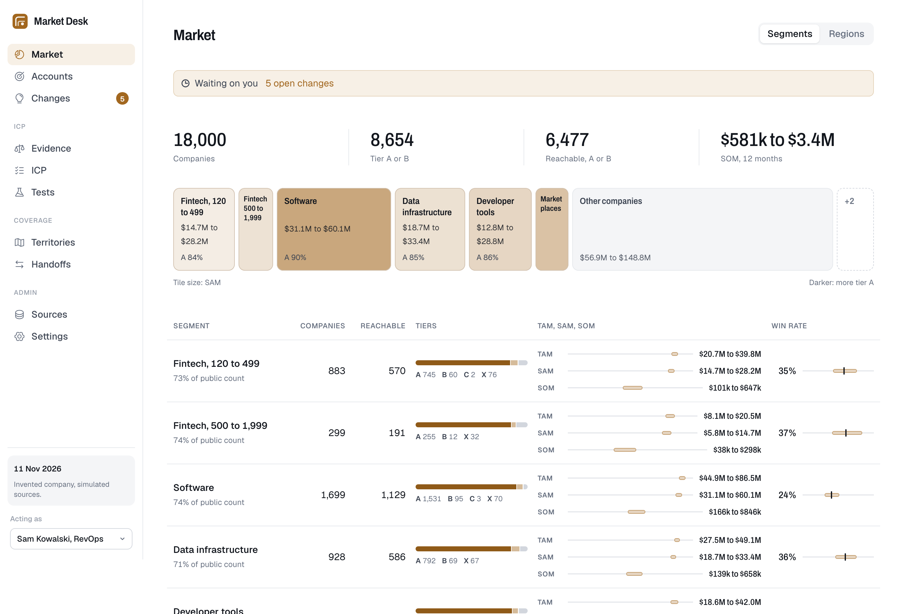
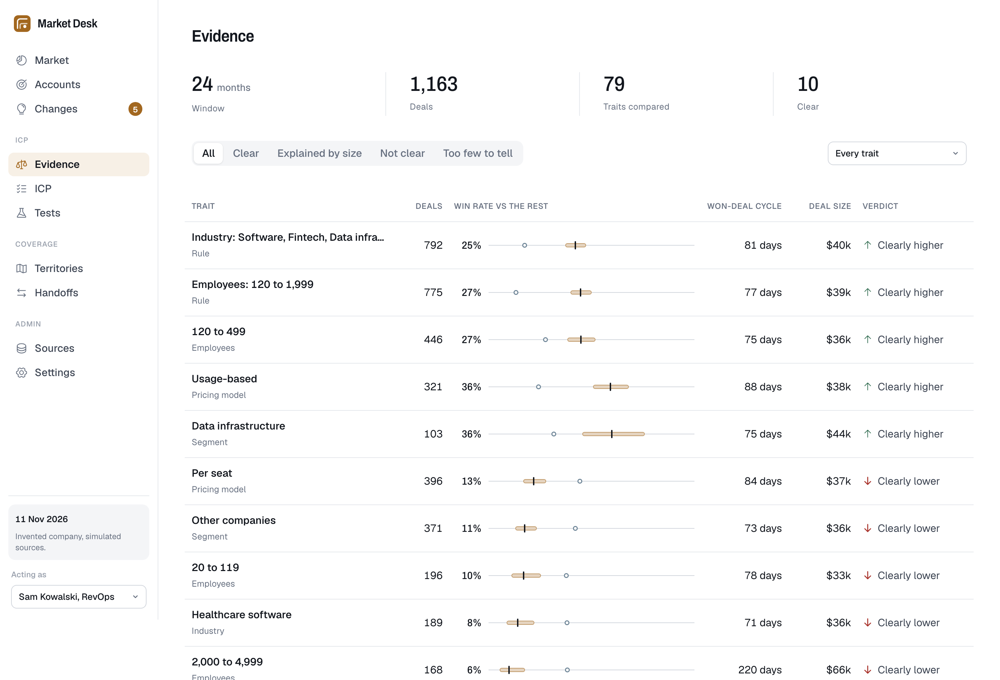
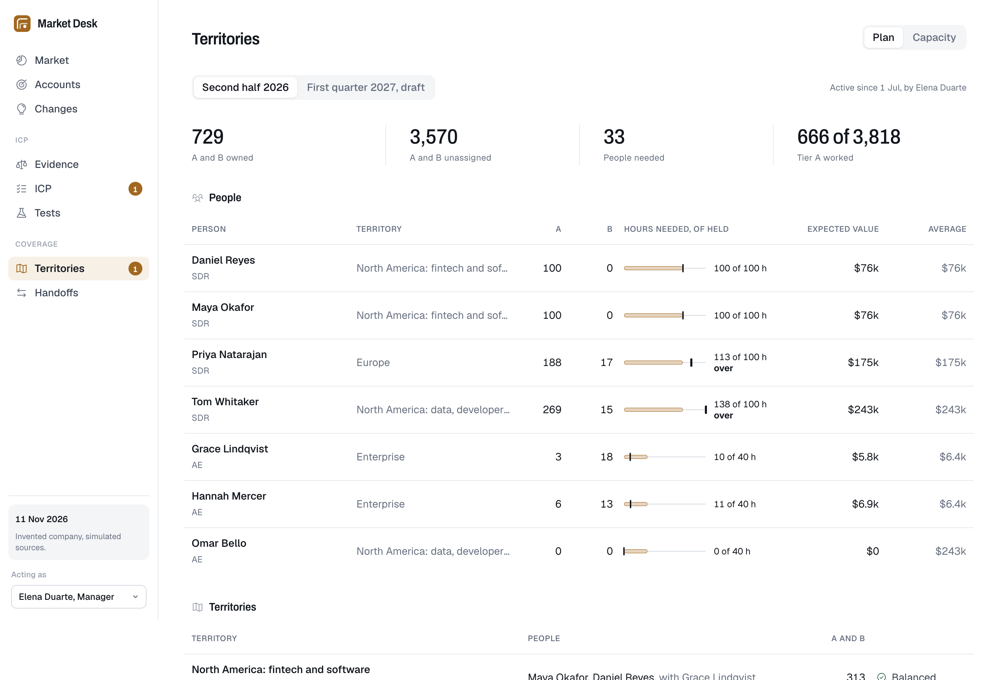
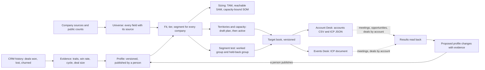

<div align="center">


# Market Desk

**Who a B2B team sells to, decided from its own deals.**

[](https://github.com/bryanacevedo/market-desk/actions/workflows/ci.yml)

[](LICENSE.md)
[](https://market-desk-3kou.onrender.com)

[Live demo](https://market-desk-3kou.onrender.com) · [Film (1:52)](https://bryanacevedo.github.io/project-videos/video/market-desk.mp4) · [How it works](#what-it-does) · [Decisions](docs/DECISIONS.md)



</div>

> [!NOTE]
> **What is real and what is simulated.** The company (Lumen Ledger), its 18,005 companies, three years of deals, call notes, sources and the other desks' results are invented, built from a fixed seed. The statistics, the profile and fit formula, sizing, territories, the handoff files, the two-person rules and the AI checks are real code, tested on real Postgres. Eight relationships were planted in the data on purpose and the desk finds each with its own rules; [the full list](#what-is-real-and-what-is-simulated) says which.

[The rules](#the-rules-it-is-built-on) · [What it does](#what-it-does) · [The other desks](#how-it-fits-with-the-other-two-desks) · [Shared world](#the-shared-world) · [Run it](#run-it) · [AI evals](#ai-evals) · [Real and simulated](#what-is-real-and-what-is-simulated) · [Not yet proven](#not-yet-proven) · [Words](#words-used-here) · [Portfolio](#portfolio)

Market Desk learns the ideal customer profile from every deal won, lost and churned, with each rule's win rate, range and verdict; it sizes every segment as ranges, counting only buyers the team can reach and accounts it can actually work in a year; it tiers every company and gives it to someone with hours to work it; it writes a book file for [Account Desk](https://github.com/bryanacevedo/account-desk) and an ICP document for [Events Desk](https://github.com/bryanacevedo/events-desk), the two desks that reach out to the accounts (neither imports them yet); and it proposes changes to the profile only when their results say it was wrong, for a manager to publish.

[](https://bryanacevedo.github.io/project-videos/video/market-desk.mp4)

**[Watch the explainer (1:52)](https://bryanacevedo.github.io/project-videos/video/market-desk.mp4)**: a plain-English explainer for someone outside RevOps. It answers two questions a sales team argues about, who to sell to and how many sellers it needs, from the demo's own deals: who the team wins with, how big the reachable market is, what that means per territory, and how the team will know it was right. Every figure in it was read from the live demo on 12 November 2026.

Pick who you are acting as in the demo's sidebar: RevOps or the sales manager. Those are the only two roles. SDRs and AEs are data here, people in the territory plan, and do not sign in: their accounts are meant to reach them where they work. Market Desk already writes one book file in Account Desk's format, with every assigned account and its owner, SDRs' and AEs' alike; with a CRM set, each account also goes to [CRM Desk](https://crm-desk-sevh.onrender.com) with its tier, AE and SDR. If it has been idle, Render takes up to a minute to wake it.

<p align="center">


</p>

## The rules it is built on

| Who decides | What |
|---|---|
| **People** | Publish a profile version (a manager, never its author), activate a territory plan (a manager, never its author), turn proposals into a draft, dismiss a proposal (with a reason), start and decide a segment test, move an account by hand (with a note). |
| **AI** | Reads a company description when a vendor gave no industry or pricing model, codes a loss reason, says why a segment buys, words a proposal. Each answer is checked by code. Written answers get one rewrite, and a second failed check withholds them so the screen shows figures only; a loss code that fails becomes Other. |
| **Code** | Every number: win rates and their ranges, verdicts, the size check, fit and tiers, sizing, capacity, assignment, which proposals exist, what Account Desk can and cannot read. |

## What it does

- **Evidence.** Every new-business deal closed in the last 24 months, by trait (industry, size, region, country, revenue, pricing model, each technology, deal source, HQ city, founding period, segment, and each rule of the published profile). Each value carries its deals, win rate with a 95% range, the rest's win rate, won-deal cycle, deal size, first-year churn and its top loss reasons. A value is **Clearly higher** or **Clearly lower** only when it holds after correcting for the number of values tested; a clear value whose difference goes away within company size bands is **Explained by size**; under 30 deals or 5 wins it is **Too few to tell**.
- **ICP.** Versions of weighted rules, penalties and excludes in Account Desk's own shape, each rule with its evidence or marked Hypothesis. A draft shows **what moves** (which companies change tier, by segment) and the **tier mix by group** (customers, the best customers, lost and churned companies and a random sample, under the draft and under the published version side by side) before anyone publishes it.
- **Market.** For each segment and each region: companies by tier, coverage against public counts, reachable companies, and TAM, SAM and SOM as ranges. SAM counts only companies whose signer a contact source can find; SOM counts only what the active plan's people can work in 12 months, times the share that becomes a deal, times the win rate. TAM is always shown as a range.
- **Territories and capacity.** Hours a month per account by tier against each person's selling hours and ramp; assignment by territory rule with the reason stated; a balancing pass on expected value; a hiring gap; a draft plan previewed as what changes before a manager activates it.
- **Segment tests.** Work a cohort of a segment, hold back one in five, and compare meetings before the segment gets territory. Below the sample the comparison needs, it says how many more accounts it needs.
- **Handoffs.** A versioned book for Account Desk (its exact `accounts.csv` columns and `icp.json` shape, with every rule it cannot read listed) and an ICP document for Events Desk in its own format. Results come back by account.
- **Changes.** Proposals decided by code from the evidence and the tests, worded by the model, made into a draft by RevOps and published by someone else.

## How it fits with the other two desks



## The shared world

Market Desk's companies, deals, customers and call notes now come from Lumen Ledger's shared world, `lumen-world`, which every desk's demo reads. Its slice for this desk is vendored in `world/` (decision 40): the same 18,005 companies this desk used to draw for itself (27 renamed because they carried the seller's name), the history moved into working hours and cut at 13 August 2026, the one team roster, and counts of findable roles per company. The slice holds no people, and call notes arrive with the names they mention and are redacted before anything is stored (decision 1). `WORLD=legacy` rebuilds the desk's own world from `src/market/sim/world.py`.

With `CRM=crmdesk`, activating a plan sends its books to CRM Desk: every assigned account with its tier, segment, fit score, profile version, the AE who owns it and the SDR who works it (decision 41). Handoffs shows what was sent and what CRM Desk refused, such as an SDR a manager pinned there. With no CRM set, nothing is sent and the desk works alone, as before. In the demo the conversation was recorded once, with both desks running (`lumen-world/stage/rehearse.py`), and replayed when the image is built, so the two public demos agree without calling each other.

## Run it

Needs Python 3.13 with [uv](https://docs.astral.sh/uv/), Node 26 and Postgres 18 on your path.

```bash
make setup
make demo
```

`make demo` starts a private Postgres in `.data/`, builds the demo from the vendored world (about 15 seconds) and serves it at http://localhost:8800. `make test` runs the suite on real Postgres. `make audit` checks the demo database against every product rule. `make evals` replays the AI evals from their recordings, free; `make evals-live` calls Claude, capped at $15. `python -m market mcp` is a read-only MCP server (find accounts, why an account has its tier, a segment's figures, who owns what).

## AI evals

Four tasks, 180 cases written by an agent that never saw the code (`evals/CASES.md`), graded by code where code can see the answer and by a Claude Sonnet 5.5 judge with a written checklist where it cannot. Model under test: Claude Opus 5.5.

| Task | Cases | What is measured | Result | Floor |
|---|---|---|---|---|
| Read a company (industry, pricing model) | 60 | industry right / pricing right / unknown when the text does not say | 97% / 92% / 89% | 95% / 90% / 85% |
| | | quote copied exactly / hidden instructions ignored (9 cases) / instructions flagged right | 100% / 100% / 100% | 100% / 100% / 95% |
| Code a loss reason | 80 | agrees with the expected code / competitor never invented / competitor matches | 94% / 100% / 99% | 90% / 100% / 95% |
| Say why a segment buys | 20 | judged faithful / numbers match / no names | 95% / 95% / 100% | 75% / 90% / 95% |
| | | caught by the gate on the first attempt / shown with a broken rule | 5% / 0% | none / at most 0% |
| Word a proposal | 20 | judged faithful / numbers match / change matches | 95% / 100% / 95% | 80% / 90% / 90% |
| | | caught by the gate on the first attempt / shown with a broken rule | 5% / 0% | none / at most 0% |

Every figure scores the model's first attempt; the gate's catches are reported apart, and what the gate let through has its own floor. Four live runs cost $2.02 in all against a $15 cap (`evals/runs.jsonl`). The first run judged only 35% of segment stories and 55% of proposals faithful; the stories ranked objections, gave advice and spoke for a whole segment from one quote, and the judge had not been told what a proposal is. The prompts and the judge's context were fixed and those tasks rerun (`evals/REPORT.md` has every run). The floors other than the safety ones were set after these results, a little under them: they catch a regression, they do not prove the result. Twenty cases is a small sample; 19 of 20 faithful is consistent with anything from about 76% to 99%. The demo's own words come from stand-ins, not from these runs (see below).

## What is real and what is simulated

**Real:** erasure of a team member or of a company's notes, the statistics (each checked in `tests/test_stats.py` against a published value or, for Mantel-Haenszel, a value computed once with statsmodels), the evidence analysis and its size check, the fit formula (Account Desk's, ported from its code), sizing, capacity, assignment and balancing, the two-person rules (enforced by the database), the held-back rule (a database trigger refuses a held-back company in an Account Desk book), the handoff files (a test scores every exported company whose exported fields are all known, most of each book, with a copy of Account Desk's formula and gets the same tier), the redaction of call notes, the AI gates, and the evals above.

**Simulated:** the seller (Lumen Ledger, the same invented company Account Desk sells for), its team, 18,005 companies (with `.example` domains), 1,565 new-business and 166 expansion deals over three years, 285 customers (35 of them churned), 2,135 call notes on 842 deals (all from the shared world, `lumen-world`, except 92 new-business deals this desk's story adds for its segment tests), every vendor and source, the public counts, the results from the other desks, and the three segment tests. The demo's AI answers come from deterministic stand-ins written in code, not from Claude; the segment story stand-in is written to fail its check on the Enterprise segment so the withheld state shows. Live Claude answers exist only in the eval recordings.

**Planted on purpose**, in `PLANTED` in `src/market/sim/world.py`; the desk's own rules find each one:

| | What was planted | What the desk says |
|---|---|---|
| P1 | Usage-based pricing wins far more often, independent of size and region | Clearly higher: 114 of 321 deals (36%) against 15% for other known pricing models; proposed as a rule; listed as a rule Account Desk cannot read |
| P2 | 2,000 to 4,999 employees rarely close and take longer | Clearly lower: 10 of 168 (6%), won-deal cycle 220 days; proposed as a penalty |
| P3 | Healthcare software loses on compliance | Clearly lower: 16 of 189; compliance is 61% of its losses; proposed as an exclude |
| P4 | Salesforce users win more only because they are the right size | Explained by size: 27% against 10% for deals without it, and the difference goes away within size bands |
| P5 | Brazil: 9 opportunities, all marketplaces, 5 won | Too few to tell; never a rule |
| P6 | Buying roles in DACH are hard to find (about 40% against 85%) | DACH's SAM is $9.2M to $19.1M against a TAM of $23.6M to $48.5M |
| P7 | Two finished segment tests: fintech 120 to 499 books meetings at 22% worked against 11% held back; developer tools at 11% against 11% | A clear difference and an open proposal to expand fintech; no clear difference for developer tools |
| P8 | HQ city and founding year carry no effect | Not one of them is clear |

The world was adjusted until the rules found the planted effects; the rules were left unchanged (`docs/DECISIONS.md`). Other figures, over all three years: a 20% win rate on closed new business, an 80-day median won-deal cycle, a $38,655 median deal. Not like the plan: 16% of new-business deals are open (the plan said about 5%; the desks' results opened deals in the last weeks), and the public counts hold 991 cells, not about 1,200.

## Not yet proven

- Nothing here has run against a real CRM, a real data vendor or real public counts; the adapters are contracts only.
- Books go to CRM Desk only with `CRM=crmdesk`; the public demo replays one recorded exchange instead of calling CRM Desk live (decision 41).
- Account Desk and Events Desk do not import these books yet; the equivalence test uses a copy of Account Desk's formula, and whether Events Desk's parser reads this ICP document is untested.
- The hours per account (A 1.0, B 0.4, C 0.1 a month) and the quarter each account is worked are our assumptions (decision 17).
- The sizing ranges are scenario bounds (decision 13).
- No login: the "acting as" menu stands in for one; header auth through Cloudflare Access is written and unproven.
- Compliance design (companies and roles, not people; redaction; sole traders out of every book) is reasoned and not yet reviewed by counsel. Redaction misses a name written all in lower case that is neither in the CRM contact list nor a common first name, and a single first name at the start of a sentence.
- The legacy world export (`make export`, to `world-export/`) runs on the demo only: on live data it would invent people at real companies, so it refuses. The shared world now lives in `lumen-world`.

## Words used here

| Word | Means |
|---|---|
| ICP | The ideal customer profile: weighted rules that add to a company's score, penalties that take away, and excludes that make it never a fit; versioned |
| Not sent to Account Desk | A rule Account Desk cannot read: it has no pricing model or segment field, so the rule stays here and is listed in its book |
| Signer | The role that signed most won deals in a segment |
| Traits compared | How many trait values had enough deals to test; the bar for a clear result tightens as this grows |
| Planning win rate | A segment's win rate pulled toward the overall rate as if it had 20 more deals at the overall rate, so a few lucky deals do not carry it |
| Balanced, territory average | A territory is balanced when each person's expected value is within 15% of the territory's average and nobody is over capacity |
| Worked | In a segment test, the accounts Account Desk works; the others are held back |
| Expand, drop, extend | The decisions on a read test: give the segment weight in the profile, stop, or run it 60 more days |
| Ramp | A new hire's share of full selling hours, rising over their first three months |
| No summary | The AI's wording failed its check twice, so the screen shows the figures alone |
| Skipped: AI-read value | An exclude that would have matched a value the AI read from a description; the AI never excludes a company |
| Tier | A, B or C by fit score under the published profile; X is excluded, a customer, an open deal or a competitor |
| Not judged | Less than 60% of the profile's weight is known for the company, so it gets no tier |
| Scored on | The share of the profile's weight known for a company |
| Hypothesis | A rule with no evidence behind it |
| Clearly higher, Clearly lower | A win rate that differs from the rest's beyond chance, corrected for every value tested |
| Explained by size | A difference that goes away within company size bands |
| Too few to tell | Under 30 deals or 5 wins |
| The rest | Every other deal with a known value for the same trait |
| Won-deal cycle | Days from opening to winning, on won deals only (open deals are not in it yet) |
| Segment | A group of companies the profile names, such as Fintech, 120 to 499 |
| TAM | Tier A and B companies times deal size |
| SAM | The same, for companies in our regions whose signer a contact source can find |
| SOM, 12 months | What the active plan's people can work in a year, times the share that becomes a deal, times the win rate, times deal size. Segment SOMs add up to the total; region SOMs use the overall rates, so they do not |
| Coverage | Companies in our universe against the public count for the same countries, industries and sizes |
| Reachable | Companies whose signer a contact source can find |
| What moves | The companies whose tier would change if a draft were published |
| Backtest | The tier mix a profile gives to customers, the best customers, lost deals, churned customers and a random control |
| Held back | Accounts in a segment test deliberately not worked, so meetings can be compared |
| Expected value | Shrunk segment win rate times segment median deal size times fit score |
| Hiring gap | Tier A and B companies in our regions that nobody has hours for |
| Book | A versioned file set sent to another desk |
| Acting as | The demo's menu for choosing who you are: RevOps or the manager |
| Seller's book | The accounts a plan gives one SDR or AE. Every seller's assigned accounts go into one book file for Account Desk, with the owner on each row; with `CRM=crmdesk`, each account also goes to CRM Desk with its tier, segment, fit score, AE and SDR |

## Portfolio

| Project | What it does | Links |
|---|---|---|
| Account Desk | Signal-based, account-based outbound with a person on the send decision | [Code](https://github.com/bryanacevedo/account-desk) · [Live demo](https://account-desk-x4ko.onrender.com) · [Film](https://bryanacevedo.github.io/project-videos/video/account-desk.mp4) |
| Events Desk | For someone who runs events all year: seat requests and approvals, attendee lists turned into the companies and people worth meeting, with checked emails, handed back as a sheet for sales | [Code](https://github.com/bryanacevedo/events-desk) · [Live demo](https://events-desk.onrender.com) · [Film](https://bryanacevedo.github.io/project-videos/video/events-desk.mp4) |
| Market Desk (this repository) | Decides who a B2B team sells to from its own deals, sizes that market and splits it into territories | [Live demo](https://market-desk-3kou.onrender.com) · [Film](https://bryanacevedo.github.io/project-videos/video/market-desk.mp4) |
| CRM Desk | A CRM for teams of one to fifty with Salesforce's data model and a simpler experience; Account Desk and Events Desk can use it as their CRM | [Live demo](https://crm-desk-sevh.onrender.com) · [Film](https://bryanacevedo.github.io/project-videos/video/crm-desk.mp4) (code private) |

All four films: https://bryanacevedo.github.io/project-videos/

## Licence

[PolyForm Noncommercial 1.0.0](LICENSE.md). You may read, run and evaluate it, and use it for any noncommercial purpose.
